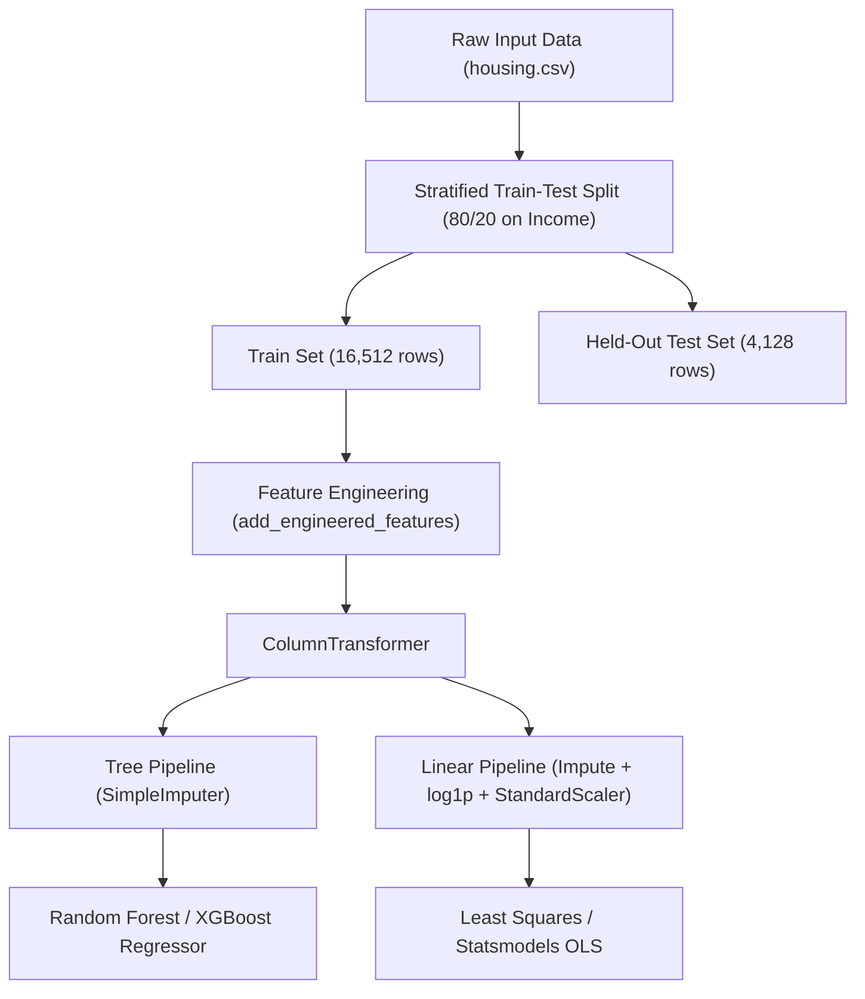

# Machine Learning Training and Engineering Process

## 1. Pipeline Architecture Overview

To avoid data leakage and maintain reproducible model deployment, all transformation logic is encapsulated inside scikit-learn `Pipeline` and `ColumnTransformer` objects located in [housing_features.py](file:///d:/Nirmay%20pc/ENGINEERING/projects/HousePricePredictor_MlModel/housing_features.py).



---

## 2. Train-Test Split Strategy

Data leakage occurs if summary statistics (such as median bedroom counts or scaling parameters) are calculated across the entire dataset before splitting.

* **Split Ratio:** 80% Training ($N = 16,512$), 20% Held-out Test ($N = 4,128$).
* **Stratification:** Because `median_income` exhibits the single strongest correlation with house values ($r \approx 0.69$), the split is stratified using 5 discrete income bins:
  $$\text{Bins} = [0, 1.5, 3.0, 4.5, 6.0, \infty)$$
* **Guaranteed Uniformity:** Stratification ensures that rare, high-income blocks are represented equally in both the training folds and the final evaluation set.

---

## 3. Data Cleaning and Preprocessing Comparisons

### 3.1 Missing Value Treatment: Imputation vs. Deletion
In `total_bedrooms`, 207 entries are missing. In [DMBI_Project_v2.ipynb](file:///d:/Nirmay%20pc/ENGINEERING/projects/HousePricePredictor_MlModel/DMBI_Project_v2.ipynb), two strategies were evaluated via 5-fold cross-validation:

1. **Row Deletion:** Dropping the 207 rows results in loss of data and cannot handle missing values during inference in production.
2. **Median Imputation inside Pipeline:** Imputing missing values with the training fold's median achieved comparable RMSE while preserving full sample power and ensuring runtime robustness.

### 3.2 Outlier Detection: IQR Rule vs. Isolation Forest
* **Tukey's IQR Rule:** Flags data points outside $[Q_1 - 1.5 \times \text{IQR}, Q_3 + 1.5 \times \text{IQR}]$. For skewed distributions (`population`, `total_rooms`), this rule over-flags legitimate high-density urban clusters.
* **Isolation Forest:** An unsupervised tree ensemble isolating anomalies in multidimensional space. Outliers identified primarily corresponded to rural census tracts with extreme land-to-population ratios or block groups with heavy right-censoring at $500,001. All points were retained in training to preserve realistic real-world geographic variance.

---

## 4. Feature Engineering

The raw features contain aggregated counts for entire block groups. Three domain-specific continuous ratios are engineered directly from raw metrics:

1. **Rooms Per Household:**
   $$\text{rooms\_per\_household} = \frac{\text{total\_rooms}}{\text{households}}$$
   *Represents average physical house size in the neighborhood.*

2. **Bedrooms Per Room:**
   $$\text{bedrooms\_per\_room} = \frac{\text{total\_bedrooms}}{\text{total\_rooms}}$$
   *Captures home layout and density; a higher proportion of bedrooms often correlates with lower property values.*

3. **Population Per Household:**
   $$\text{population\_per\_household} = \frac{\text{population}}{\text{households}}$$
   *Measures neighborhood household crowding.*

### Preprocessing Pipelines by Model Family
* **Tree Models (`kind="tree"`):**
  - Numeric features: `SimpleImputer(strategy="median")`. Tree partitions are monotonic and scale-invariant; standard scaling is omitted.
  - Categorical (`ocean_proximity`): `OneHotEncoder(handle_unknown="ignore", sparse_output=False)`.
* **Linear Models (`kind="linear"`):**
  - Right-skewed features (`total_rooms`, `total_bedrooms`, `population`, `households`, `median_income`, and all 3 engineered ratios): `SimpleImputer` $\rightarrow$ `FunctionTransformer(np.log1p)` $\rightarrow$ `StandardScaler()`.
  - Non-skewed numeric (`housing_median_age`, `latitude`, `longitude`): `SimpleImputer` $\rightarrow$ `StandardScaler()`.
  - Categorical: `OneHotEncoder(drop="first", handle_unknown="ignore")` to prevent the dummy variable trap (multicollinearity).

---

## 5. Mathematical Least Squares from First Principles

In [DMBI_Project_v2.ipynb](file:///d:/Nirmay%20pc/ENGINEERING/projects/HousePricePredictor_MlModel/DMBI_Project_v2.ipynb) Section 9, ordinary least squares is derived and verified across three independent implementations:

### 5.1 Normal Equations
$$\boldsymbol{\theta} = (\mathbf{X}^T \mathbf{X})^{-1} \mathbf{X}^T \mathbf{y}$$
* Solved analytically using numpy matrix inversion.
* Limitations: Inversion of $\mathbf{X}^T \mathbf{X}$ is numerically unstable when features exhibit collinearity ($\kappa(\mathbf{X}) \gg 1$).

### 5.2 Singular Value Decomposition (SVD)
$$\mathbf{X} = \mathbf{U} \mathbf{\Sigma} \mathbf{V}^T \implies \boldsymbol{\theta} = \mathbf{V} \mathbf{\Sigma}^+ \mathbf{U}^T \mathbf{y}$$
* Solved via `np.linalg.lstsq(X, y, rcond=None)`.
* Confirmed exact parameter agreement ($\Delta < 10^{-10}$) with scikit-learn's `LinearRegression`.

### 5.3 Econometric Diagnostics (`statsmodels.OLS`)
* **Variance Inflation Factor (VIF):** Evaluated across features. High VIF values between `total_rooms` and `households` justified the engineered ratio features.
* **OLS Coefficients:** Identified `median_income` as the most statistically significant positive linear predictor ($p < 0.001$), followed by coastal proximity.

---

## 6. Model Zoo and Training Regimes

Five candidate configurations were evaluated under identical 5-fold cross-validation folds:

1. **Baseline (Dummy Mean):** Trivial regressor predicting the sample mean of the training fold. Provides the benchmark floor ($R^2 \approx 0.0$).
2. **Linear Regression (Raw Target):** OLS model trained on standardized and log-transformed features.
3. **Linear Regression (Log Target):** OLS model trained with target $y' = \log(y)$, evaluated by inverting predictions $\hat{y} = \exp(\hat{y}')$.
4. **Random Forest Regressor:** Non-linear ensemble of 500 decision trees parallelized across all available CPU cores.
5. **XGBoost Regressor (GPU-Accelerated):** Gradient boosted trees using the fast histogram algorithm (`tree_method="hist"`), executed directly on the NVIDIA GeForce RTX 3050 GPU via CUDA (`device="cuda"`).

---

## 7. Hyperparameter Tuning

Hyperparameter optimization was executed using `RandomizedSearchCV` across 5 cross-validation folds scoring on negative root mean squared error (`neg_root_mean_squared_error`).

### 7.1 Random Forest Search Space & Optimal Parameters
* **Search Grid:**
  - `n_estimators`: $[100, 200, 300, 500]$
  - `max_depth`: $[15, 20, 25, 30, \text{None}]$
  - `max_features`: $[0.3, 0.5, 0.7, 1.0]$
  - `min_samples_leaf`: $[1, 2, 4]$
* **Winning Parameters:**
  ```python
  {
      "model__n_estimators": 500,
      "model__max_depth": 30,
      "model__max_features": 0.5,
      "model__min_samples_leaf": 1
  }
  ```
* **Tuning Time:** 296.69 seconds (CPU, all cores).

### 7.2 XGBoost Search Space & Optimal Parameters
* **Search Grid:**
  - `n_estimators`: $[500, 800, 1000, 1200, 1500]$
  - `learning_rate`: $[0.01, 0.02, 0.03, 0.05, 0.1]$
  - `max_depth`: $[5, 6, 7, 8, 10]$
  - `subsample`: $[0.6, 0.7, 0.8, 0.9]$
  - `colsample_bytree`: $[0.5, 0.6, 0.7, 0.8]$
  - `reg_lambda`: $[1, 3, 5, 10]$
  - `min_child_weight`: $[1, 3, 5]$
* **Winning Parameters:**
  ```python
  {
      "model__n_estimators": 1200,
      "model__learning_rate": 0.03,
      "model__max_depth": 8,
      "model__subsample": 0.7,
      "model__colsample_bytree": 0.6,
      "model__reg_lambda": 5,
      "model__min_child_weight": 1
  }
  ```
* **Tuning Time:** 319.38 seconds (GPU CUDA).

---

## 8. Helper Models for the Interactive App

In a production environment, typical users know physical property details and neighborhood locations on a map, but they cannot provide aggregate census statistics such as the 1990 census median income or exact coastal classification.

To solve this, two helper models were trained in [Trainer_helper_model.ipynb](file:///d:/Nirmay%20pc/ENGINEERING/projects/HousePricePredictor_MlModel/Trainer_helper_model.ipynb) using only geospatial coordinates (`latitude`, `longitude`):

### 8.1 Ocean Proximity Classifier
* **Model:** $k$-Nearest Neighbors Classifier (`KNeighborsClassifier`).
* **Parameters:** $k = 3$, `weights="distance"`.
* **Validation Performance:**
  - 5-fold CV Accuracy: **99.01%**
  - Held-out Test Accuracy: **99.18%**
* **Deployment Purpose:** Maps clicked map coordinates directly to coastal tiers (`<1H OCEAN`, `INLAND`, `NEAR OCEAN`, `NEAR BAY`, `ISLAND`).

### 8.2 Median Income Spatial Regressor
Three regressors were benchmarked to predict neighborhood income from coordinates:

| Candidate Model | 5-Fold CV $R^2$ | 5-Fold CV MAE | 5-Fold CV RMSE | Training Time |
|---|---|---|---|---|
| **Random Forest** | **0.565 ± 0.011** | **0.871 ± 0.014** | **1.256 ± 0.028** | 13.1 s |
| $k$-NN Regressor | 0.505 ± 0.006 | 0.924 ± 0.010 | 1.340 ± 0.020 | 0.1 s |
| XGBoost (CUDA) | 0.491 ± 0.007 | 0.934 ± 0.016 | 1.359 ± 0.028 | 42.7 s |

* **Selected Model:** **Random Forest** achieved the highest $R^2$ (0.565) and lowest error. Saved as [models/income_model.joblib](file:///d:/Nirmay%20pc/ENGINEERING/projects/HousePricePredictor_MlModel/models/income_model.joblib).
